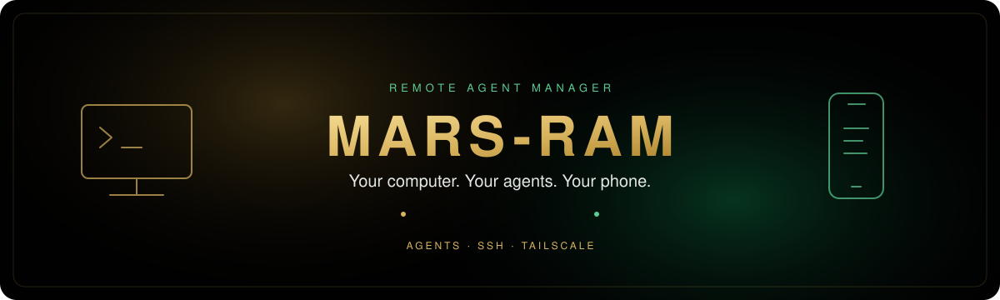
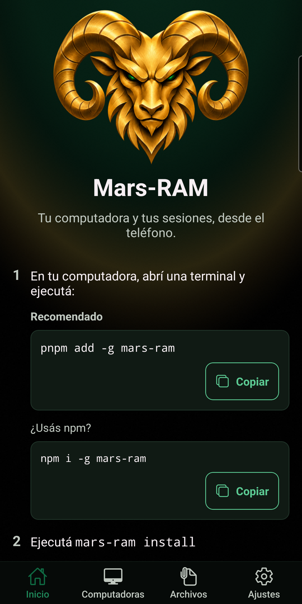
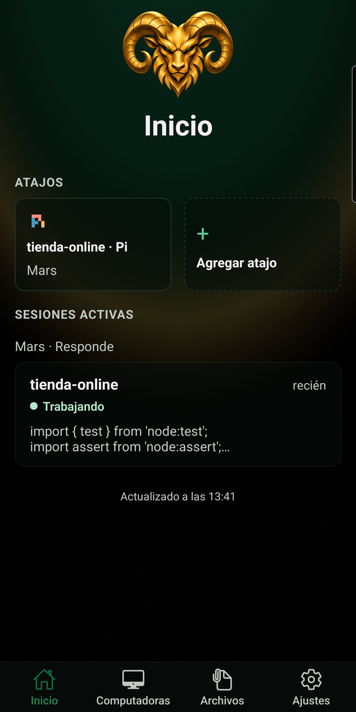
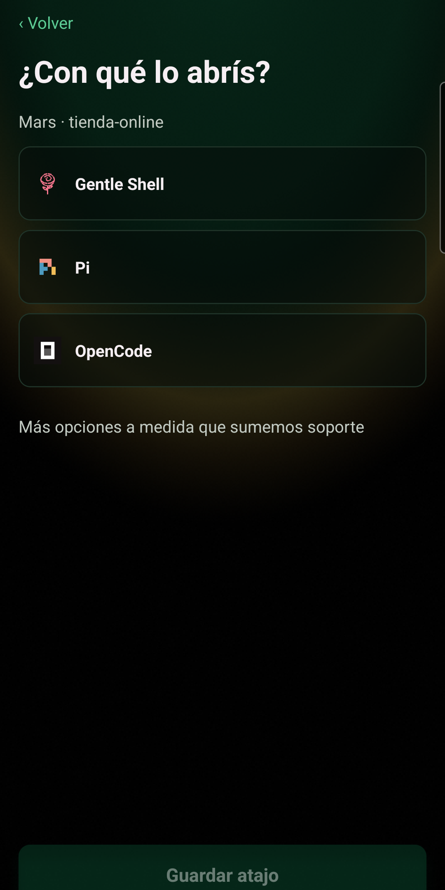
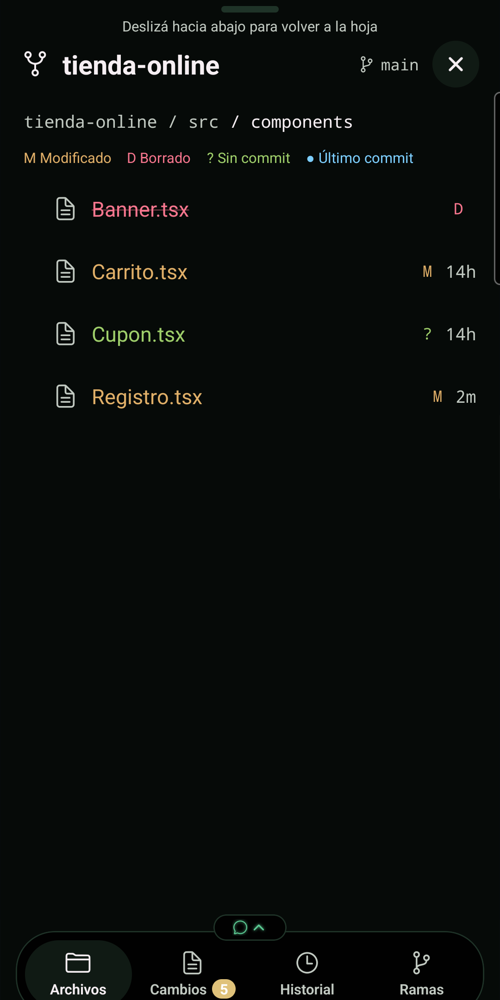
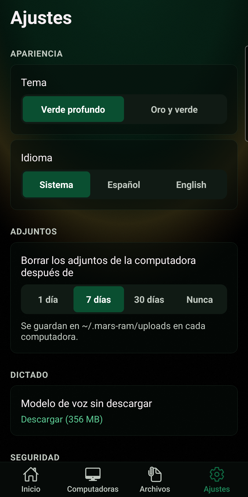
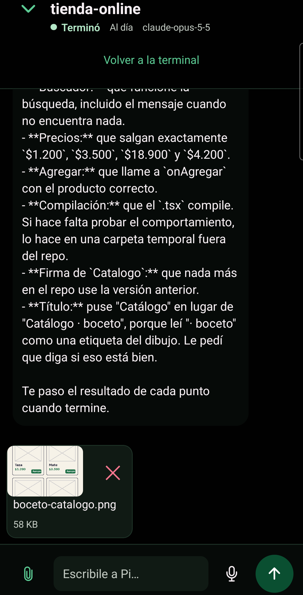

<a id="top"></a>

<p align="right">
  <a href="./README.md"></a>
  
</p>

<p align="center">
  
</p>

<p align="center">
  
</p>

<h1 align="center">Mars-RAM</h1>

<p align="center"><strong>Las sesiones de agentes de programación de tu computadora, desde tu teléfono Android.</strong></p>

<div align="center">

[](https://www.npmjs.com/package/mars-ram)
[](https://github.com/MarsSall/mars-ram/actions/workflows/ci.yml)
[](https://github.com/MarsSall/mars-ram/commits)
[](https://github.com/MarsSall/mars-ram/stargazers)


</div>

<p align="center"><strong><a href="#install">Instalación</a> &nbsp;·&nbsp; <a href="#screenshots">Capturas</a> &nbsp;·&nbsp; <a href="./docs/install.es.md">Documentación</a> &nbsp;·&nbsp; <a href="./docs/privacy.es.md">Privacidad</a></strong></p>

<p align="center">Tus agentes siguen trabajando en tu escritorio. Vos no tenés que quedarte ahí.<br /><strong>Seguí las sesiones de agentes en vivo, respondé desde el chat o la terminal completa y retomá el trabajo en tu computadora.</strong></p>

<p align="center"><sub><strong>HECHO PARA AGENTES DE PROGRAMACIÓN</strong> &nbsp;·&nbsp; Tailscale o ZeroTier &nbsp;·&nbsp; Sin cuenta de Mars-RAM &nbsp;·&nbsp; Sin nube operada por nosotros</sub></p>

<p align="center"></p>

<a id="stack"></a>

## Stack

<div align="center">
<a href="https://github.com/Gentleman-Programming/gentle-ai">
  
</a>
</div>

<div align="center">


</div>

<p align="center"></p>

<a id="what-is-it"></a>

## Qué es

Mars-RAM (Remote Agent Manager) conecta tu teléfono Android con tus propias computadoras por SSH, sobre tu red de Tailscale o, como alternativa, de ZeroTier. Seguí las sesiones de agentes en vivo, respondé desde el chat o la terminal completa y retomá el trabajo en tu escritorio.

Sesiones en vivo con chat: hoy con Pi; se van a sumar más agentes. La terminal completa de Herdr funciona con cualquier agente o programa.

Sin cuenta de Mars-RAM ni servicio en la nube operado por nosotros. Las sesiones corren en tus computadoras; el teléfono es otra forma de acceder a ellas.

<p align="center"></p>

<a id="install"></a>

## Instalación

**App para Android:** Google Play — próximamente.

**En tu computadora**, necesitás:

- [Node.js](https://nodejs.org) **24 o más nuevo** y [Pi](https://pi.dev) para las sesiones en vivo con chat.
- [Tailscale](https://tailscale.com) en la computadora y en el teléfono (o ZeroTier, mirá más abajo). En macOS alcanza con la app de Tailscale: Mars-RAM encuentra su comando dentro de `Tailscale.app`.
- Un servidor SSH: `sshd` en Linux, **Sesión remota** (Remote Login) en macOS u **OpenSSH Server** en Windows.

Instalá el comando para la computadora con pnpm (recomendado):

```sh
pnpm add -g mars-ram
mars-ram install
mars-ram pair
```

Escaneá el código QR desde la app o abrí en el teléfono el link de vinculación que aparece en la terminal. En la app, **Agregar computadora** te guía paso a paso por Tailscale o ZeroTier: revisa la app de red del teléfono (y el DNS privado, con Tailscale), te da estos comandos para cada sistema y te explica por qué falló un escaneo. La instalación es para tu usuario, sin permisos de administrador; en Windows, usá una terminal normal para `mars-ram install`, y una terminal de administrador para `mars-ram pair` si tu usuario es administrador.

**¿ZeroTier en vez de Tailscale?** Ejecutá `mars-ram pair-zt` (agregá `--address <ipv4>` si la computadora está en varias redes de ZeroTier). Necesita una versión de la app compatible con ZeroTier; por ZeroTier funcionan las sesiones por SSH, la terminal y los archivos, mientras que los links privados y Siempre atento siguen necesitando Tailscale. `mars-ram pair` sigue usando Tailscale. En Linux con un firewall (ufw o firewalld) activo, `pair-zt` y `mars-ram doctor` muestran el comando exacto para dejar pasar ZeroTier, como `sudo ufw allow in on <interfaz de ZeroTier> comment 'ZeroTier'`; Tailscale no lo necesita.

¿Preferís npm? Reemplazá el primer comando por `npm i -g mars-ram`.

**Alternativa para Linux / macOS:**

```sh
curl -fsSL https://marssall.github.io/mars-ram/install.sh | sh
```

Después ejecutá `mars-ram pair`. La [guía de instalación completa](./docs/install.es.md) explica los requisitos, cómo revisar el instalador antes de ejecutarlo y cómo resolver problemas.

**Actualizar:** ejecutá de nuevo `pnpm add -g mars-ram` (o `npm i -g mars-ram`) y después `mars-ram install`. La versión 9 de la app necesita mars-ram 0.1.5 y te da los comandos para actualizar; después, escribí `/reload` en cada sesión de Pi que ya esté abierta. Si `mars-ram doctor` sigue diciendo que hay copias desactualizadas, ejecutá `mars-ram install` otra vez. Mirá el [registro de cambios](./CHANGELOG.md) (en inglés).

**Diagnosticar:** ejecutá `mars-ram doctor` para revisar la configuración sin modificarla.

**¿El teléfono no encuentra la computadora por Tailscale?** El DNS privado de Android saltea el MagicDNS de Tailscale. Apagalo (Ajustes › Conexiones › Más ajustes de conexión › DNS privado › Desactivado) y escaneá un código nuevo; la app te avisa cuando lo detecta.

**Desinstalar:** ejecutá `mars-ram uninstall` y después `pnpm remove -g mars-ram` (o `npm uninstall -g mars-ram`). Esto quita la integración y el paquete, no los archivos compartidos ni la autorización del teléfono en la computadora; mirá [Privacidad y datos locales](#privacidad-y-datos-locales).

<a id="quick-start"></a>

## Primeros pasos

Una vez vinculado el teléfono:

1. Abrí tu computadora en la app y elegí una sesión de agentes en vivo para seguirla o responder.
2. Usá la terminal completa de Herdr cuando necesites el teclado, o el chat para enviar una instrucción, foto o archivo.
3. Agregá un atajo para abrir Gentle Shell, Pi u OpenCode en un repositorio sin escribir el comando cada vez.

<p align="center"></p>

<a id="screenshots"></a>

## Capturas

<p align="center">App para Android · Interfaz en español · Contenido de demostración</p>

<table align="center">
  <tr>
    <td align="center"><br /><sub><strong>Bienvenida</strong></sub></td>
    <td align="center"><br /><sub><strong>Sesiones de un vistazo</strong></sub></td>
    <td align="center"><br /><sub><strong>Atajos guiados</strong></sub></td>
  </tr>
  <tr>
    <td align="center"><br /><sub><strong>Archivos del proyecto</strong></sub></td>
    <td align="center"><br /><sub><strong>Ajustes</strong></sub></td>
    <td align="center"><br /><sub><strong>Fotos en el chat</strong></sub></td>
  </tr>
</table>

<p align="center"></p>

<a id="features"></a>

## Funciones

| Función | Qué podés hacer |
| --- | --- |
| **Conexión guiada** | Agregá una computadora paso a paso por Tailscale o ZeroTier; si el escaneo falla, la app te dice qué revisar. |
| **ZeroTier como alternativa** | Vinculá con `mars-ram pair-zt` para las sesiones, la terminal y los archivos; los links privados y Siempre atento siguen necesitando Tailscale. |
| **Sesiones de agentes en vivo** | Leé, respondé y frená una sesión desde el teléfono. |
| **Terminal completa** | Usá cualquier agente o programa en Herdr, con una barra de teclas pensada para una mano y sin sugerencias del teclado. Recuerda el tamaño de letra; cambialo pellizcando o en Ajustes. |
| **Atajos guiados** | Abrí Gentle Shell, Pi u OpenCode en un repositorio. |
| **Archivos del proyecto** | Explorá archivos con su estado en git, diffs e historial. |
| **Dictado en el dispositivo** | Convertí voz en texto en tu teléfono; el audio no se envía por la red. El modelo de voz se descarga en segundo plano, aunque cierres la app. |
| **Fotos y archivos** | Adjuntalos a una sesión (quedan en una carpeta temporal privada de tu usuario en la computadora) o compartí una copia con un link privado en tu tailnet. |
| **Vinculación por QR o link** | La clave privada SSH queda en el Keystore de Android y, por defecto, requiere desbloquear el dispositivo. |

<p align="center"></p>

<a id="architecture"></a>

## Arquitectura

| Ruta | Responsabilidad |
| --- | --- |
| [`apps/mobile`](./apps/mobile/) | Cliente Android: interfaz en React Native / Expo y módulo SSH nativo en Kotlin |
| [`host/cli`](./host/cli/) | Instalación, vinculación, diagnóstico y herramientas de archivos y Git en la computadora |
| [`host/pi-bridge`](./host/pi-bridge/) | Extensión de Pi que expone cada sesión en vivo por HTTP local y eventos |
| [`host/link-server`](./host/link-server/) | Sirve copias privadas de archivos con vencimiento en la dirección de Tailscale de la computadora |
| [`packages/protocol`](./packages/protocol/) | Esquemas compartidos y versionados de solicitudes, respuestas y eventos, con pruebas de contrato |
| [`docs/`](./docs/) | Instalación, arquitectura, privacidad y documentación técnica |

La app, los componentes de la computadora y el protocolo siguen límites hexagonales: reglas en el núcleo y tecnología detrás de puertos y adaptadores. Consultá el [documento de arquitectura](./docs/architecture.md) (en inglés).

<p align="center"></p>

<a id="privacy-and-local-data"></a>
<a id="privacidad-y-datos-locales"></a>

## Privacidad y datos locales

- **Sin analítica, publicidad ni rastreo.** Mars-RAM no opera un backend. Tailscale y los agentes o proveedores de modelos que uses tienen sus propias políticas; el contenido que enviás a una sesión llega a esos programas en tu computadora.
- **Datos en el teléfono.** Las computadoras guardadas, sus identidades verificadas, los ajustes y el modelo de voz descargado quedan en el almacenamiento de la app; la clave privada SSH queda en el Keystore de Android. Los borradores y el audio del dictado se mantienen en memoria. Las fotos y los archivos elegidos pueden quedar en caché.
- **Voz.** La transcripción corre en el dispositivo. Descargar el modelo de voz opcional contacta a Hugging Face y a los servidores de descarga a los que redirija; pueden ver información habitual de la solicitud, incluida tu dirección IP.
- **Datos en la computadora.** Los adjuntos van a una carpeta privada de tu usuario dentro de la carpeta temporal del sistema (`/tmp/mars-ram-<uid>/uploads` en Linux y macOS, `%TEMP%\mars-ram\uploads` en Windows), nunca a tu carpeta personal, con limpieza al conectar cuando sea posible (1, 7 o 30 días, o nunca) y lo que borre la limpieza de temporales del sistema. `mars-ram install` borra la carpeta anterior `~/.mars-ram/uploads`. Los links privados sirven copias de `~/.mars-ram/links` durante un día; cualquier persona de la tailnet que tenga el link puede abrirlo hasta que venza o lo borres.
- **Borrado.** Desinstalar la app de Android elimina sus datos y su clave, no las copias en tus computadoras. Olvidar una computadora no revoca su clave pública autorizada. `mars-ram uninstall` conserva archivos compartidos, datos de links, claves de autorización del teléfono y el registro de sesiones; borrá por separado las copias y claves que ya no quieras.

Leé la [política de privacidad completa](./docs/privacy.es.md).

<p align="center"></p>

<a id="contributing"></a>

## Cómo contribuir

Las preguntas, los reportes de errores y las sugerencias son bienvenidos en [GitHub Issues](https://github.com/MarsSall/mars-ram/issues). Reportá vulnerabilidades de seguridad en privado: [abrí un aviso de seguridad privado en GitHub](https://github.com/MarsSall/mars-ram/security/advisories/new), no un issue público. Publicar el código para su revisión no otorga una licencia para reutilizarlo.

<a id="license"></a>

## Licencia

Copyright © 2026 MarsSall. Todos los derechos reservados. El código fuente se publica para ofrecer transparencia y permitir su revisión; no se otorga ninguna licencia para copiarlo, modificarlo o redistribuirlo.

Mars-RAM no está afiliado a las herramientas y los servicios con los que se conecta. Las marcas pertenecen a sus respectivos titulares.

<p align="center"></p>

<p align="center"><sub><strong>Si Mars-RAM te ayuda a seguir conectado con tu trabajo, <a href="https://github.com/MarsSall/mars-ram/stargazers">una estrella ayuda a que otras personas lo descubran.</a></strong></sub></p>

<p align="center"><a href="#top">Volver arriba ↑</a></p>
