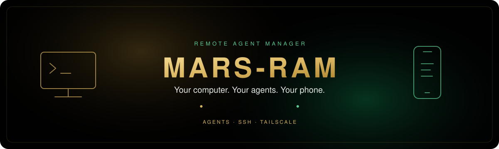
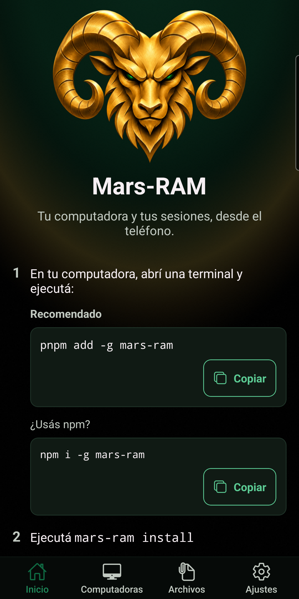
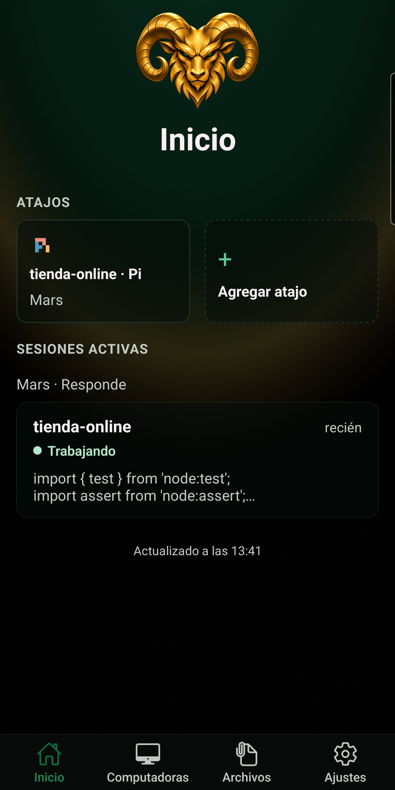
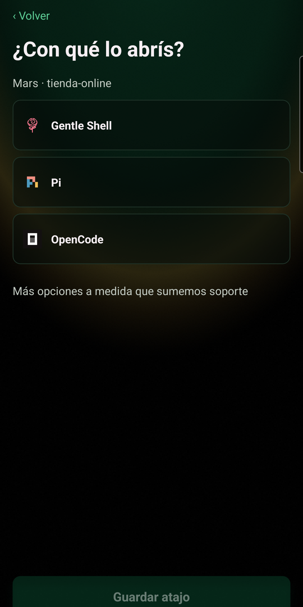
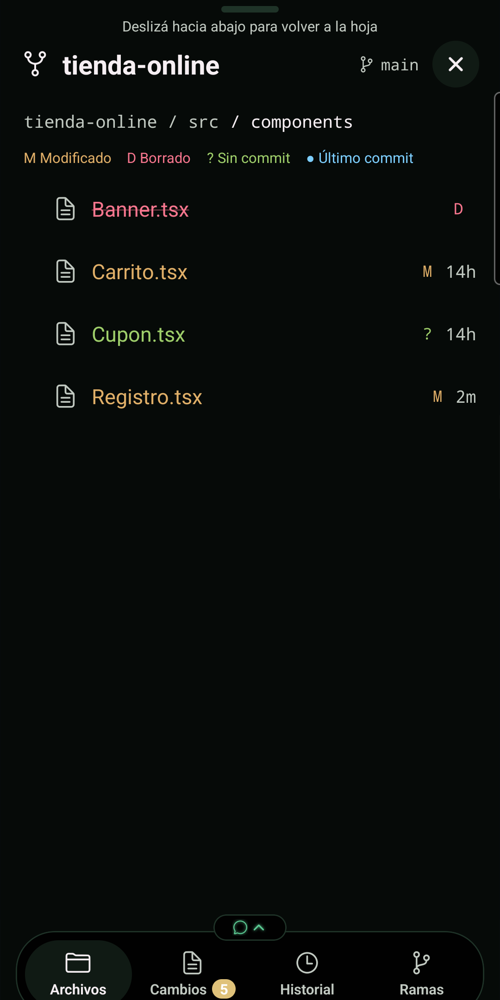
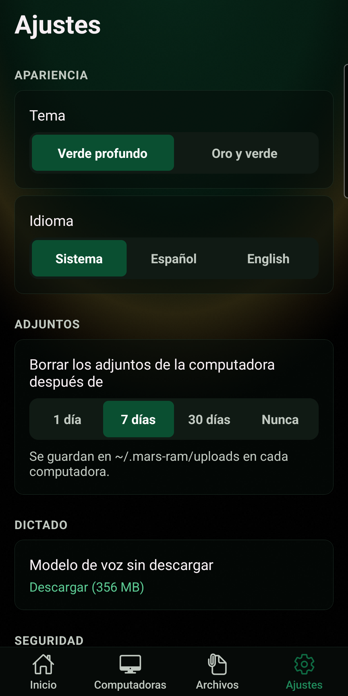
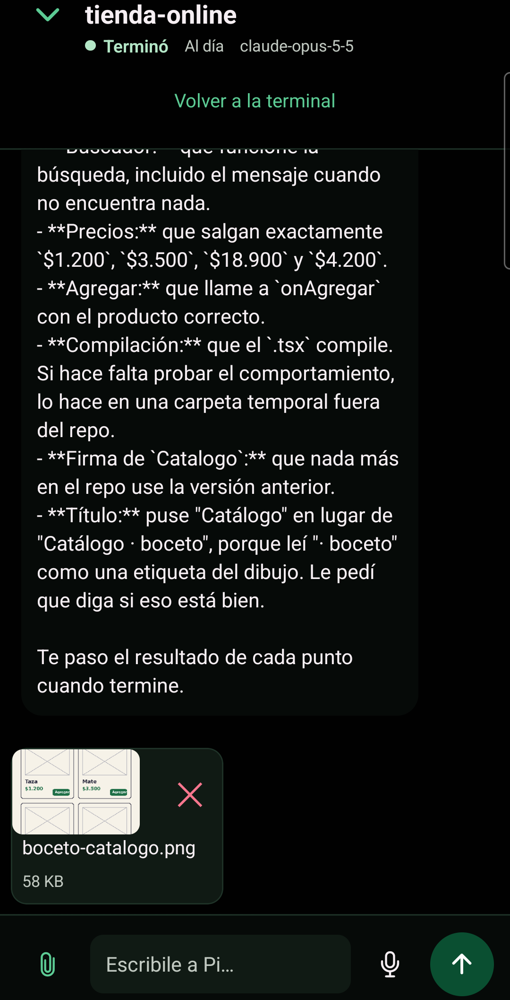

<a id="top"></a>

<p align="right">
  
  <a href="./README.es.md"></a>
</p>

<p align="center">
  
</p>

<p align="center">
  
</p>

<h1 align="center">Mars-RAM</h1>

<p align="center"><strong>Your computer's coding-agent sessions, from your Android phone.</strong></p>

<div align="center">

[](https://www.npmjs.com/package/mars-ram)
[](https://github.com/MarsSall/mars-ram/actions/workflows/ci.yml)
[](https://github.com/MarsSall/mars-ram/commits)
[](https://github.com/MarsSall/mars-ram/stargazers)


</div>

<p align="center"><strong><a href="#install">Install</a> &nbsp;·&nbsp; <a href="#screenshots">Screenshots</a> &nbsp;·&nbsp; <a href="./docs/install.md">Docs</a> &nbsp;·&nbsp; <a href="./docs/privacy.md">Privacy</a></strong></p>

<p align="center">Your agents are running at your desk. You don't have to stay there.<br /><strong>Follow live agent sessions, reply from chat or a full terminal, and pick up again at your computer.</strong></p>

<p align="center"><sub><strong>BUILT FOR CODING AGENTS</strong> &nbsp;·&nbsp; Tailscale or ZeroTier &nbsp;·&nbsp; No Mars-RAM account &nbsp;·&nbsp; No operator-run cloud</sub></p>

<p align="center"></p>

<a id="stack"></a>

## Stack

<div align="center">
<a href="https://github.com/Gentleman-Programming/gentle-ai">
  
</a>
</div>

<div align="center">


</div>

<p align="center"></p>

<a id="what-is-it"></a>

## What is it

Mars-RAM (Remote Agent Manager) connects your Android phone to your own computers over SSH on your Tailscale network, or on ZeroTier as an alternative. Follow live agent sessions, answer from chat or the full terminal, and pick up again at your desk.

Live sessions with chat: Pi today; more agents are planned. The full Herdr terminal works with any agent or program.

No Mars-RAM account, no operator-run cloud service. Your computers run the sessions; your phone is another way to reach them.

<p align="center"></p>

<a id="install"></a>

## Install

**Android app:** Google Play — coming soon.

**On your computer**, you need:

- [Node.js](https://nodejs.org) **24 or newer** and [Pi](https://pi.dev) for live sessions with chat.
- [Tailscale](https://tailscale.com) on both the computer and the phone (or ZeroTier, see below). On macOS the Tailscale app is enough: Mars-RAM finds its command inside `Tailscale.app`.
- An SSH server: Linux `sshd`, macOS **Remote Login**, or Windows **OpenSSH Server**.

Install the host command with pnpm (recommended):

```sh
pnpm add -g mars-ram
mars-ram install
mars-ram pair
```

Scan the QR code in the app, or open the printed pairing link on your phone. In the app, **Add computer** guides you step by step over Tailscale or ZeroTier: it checks the phone's network app (and Private DNS for Tailscale), gives these commands per system, and explains a failed scan. Setup runs for your user, without administrator rights; on Windows, use a normal terminal for `mars-ram install`, and an administrator terminal for `mars-ram pair` if your user is an administrator.

**ZeroTier instead of Tailscale?** Run `mars-ram pair-zt` (add `--address <ipv4>` if the computer is in several ZeroTier networks). It needs an app version that supports ZeroTier; SSH sessions, the terminal and files work over ZeroTier, and with an up-to-date app and computer (`mars-ram install`) so do private links (served only on the computer's ZeroTier address) and Siempre atento. Android runs one VPN at a time: notices from a ZeroTier computer arrive only while ZeroTier is on, and from a Tailscale computer only while Tailscale is on. Plain `mars-ram pair` keeps using Tailscale. On Linux with a firewall (ufw or firewalld) on, `pair-zt` and `mars-ram doctor` print the exact command to let ZeroTier in, such as `sudo ufw allow in on <ZeroTier interface> comment 'ZeroTier'`, which also lets in private links (port 47811); Tailscale does not need it.

Prefer npm? Replace the first command with `npm i -g mars-ram`.

**Linux / macOS alternative:**

```sh
curl -fsSL https://marssall.github.io/mars-ram/install.sh | sh
```

Then run `mars-ram pair`. See the [full installation guide](./docs/install.md) for prerequisites, inspecting the installer before running it, and troubleshooting.

**Update:** run `pnpm add -g mars-ram` (or `npm i -g mars-ram`) again, then `mars-ram install`. App build 10 needs mars-ram 0.1.6 and gives you the update commands. Coming from 0.1.5, running Pi sessions need no `/reload` (the protocol is still 1.7); from an older version, type `/reload` in each running Pi session. If `mars-ram doctor` still reports outdated copies, run `mars-ram install` again. See the [changelog](./CHANGELOG.md).

**Diagnose:** run `mars-ram doctor` for read-only setup checks.

**Phone can't find the computer over Tailscale?** Android's Private DNS bypasses Tailscale's MagicDNS. Turn it off (Settings › Connections › More connection settings › Private DNS › Off) and scan a new code; the app warns you when it detects this.

**Uninstall:** run `mars-ram uninstall`, then `pnpm remove -g mars-ram` (or `npm uninstall -g mars-ram`). This removes the integration and package, not shared files or the phone's authorization on the computer; see [Privacy and local data](#privacy-and-local-data).

<a id="quick-start"></a>

## Quick start

Once your phone is paired:

1. Open your computer in the app and choose a live agent session to follow or answer it.
2. Use the full Herdr terminal when you need the keyboard, or chat to send an instruction, photo or file.
3. Add a shortcut to open Gentle Shell, Pi or OpenCode in a repository without typing the launch command each time.

<p align="center"></p>

<a id="screenshots"></a>

## Screenshots

<p align="center">Android app · Spanish interface · Demo content</p>

<table align="center">
  <tr>
    <td align="center"><br /><sub><strong>Welcome</strong></sub></td>
    <td align="center"><br /><sub><strong>Sessions at a glance</strong></sub></td>
    <td align="center"><br /><sub><strong>Guided shortcuts</strong></sub></td>
  </tr>
  <tr>
    <td align="center"><br /><sub><strong>Project files</strong></sub></td>
    <td align="center"><br /><sub><strong>Settings</strong></sub></td>
    <td align="center"><br /><sub><strong>Photos in chat</strong></sub></td>
  </tr>
</table>

<p align="center"></p>

<a id="features"></a>

## Features

| Feature | What you can do |
| --- | --- |
| **Guided connection** | Add a computer step by step over Tailscale or ZeroTier; if the scan fails, the app says what to check. |
| **ZeroTier as an alternative** | Pair with `mars-ram pair-zt` for sessions, the terminal, files, private links and Siempre atento. |
| **Live agent sessions** | Read, answer and stop a session from the phone. |
| **Full terminal** | Use any agent or program in Herdr, with a key bar designed for one hand and no keyboard suggestions. Reorder the bar and the floating D-pad by dragging, pick keys from a list or make your own buttons (Settings › Customize keys). The text size is remembered; change it with a pinch or in Settings. |
| **Guided shortcuts** | Open Gentle Shell, Pi or OpenCode in a repository. |
| **Project files** | Browse files with their git state, diffs and history. Secret files such as `.env` and private keys stay hidden until you tap Show. |
| **On-device dictation** | Turn speech into text on your phone; audio is not sent over the network. The voice model downloads in the background, even if you close the app. |
| **Photos and files** | Attach them to a session (they land in a private per-user temp folder on the computer), or share a copy through a private link on your Tailscale or ZeroTier network. |
| **QR or link pairing** | The SSH private key stays in the Android Keystore, with device unlock required by default. |

<p align="center"></p>

<a id="architecture"></a>

## Architecture

| Path | Responsibility |
| --- | --- |
| [`apps/mobile`](./apps/mobile/) | Android client: React Native / Expo UI and a Kotlin native SSH module |
| [`host/cli`](./host/cli/) | Host installation, pairing, diagnostics, project files and Git helpers |
| [`host/pi-bridge`](./host/pi-bridge/) | Pi extension exposing each live session through loopback HTTP and events |
| [`host/link-server`](./host/link-server/) | Serves expiring private file copies on the computer's tailnet address and, for computers paired over ZeroTier, on their ZeroTier address; also sends Siempre atento notices |
| [`packages/protocol`](./packages/protocol/) | Shared versioned request, response and event schemas and contract tests |
| [`docs/`](./docs/) | Installation, architecture, privacy and technical documentation |

The app, host components and protocol follow hexagonal boundaries: rules in the core, technology behind ports and adapters. See [the architecture document](./docs/architecture.md).

<p align="center"></p>

<a id="privacy-and-local-data"></a>

## Privacy and local data

- **No analytics, advertising or tracking.** Mars-RAM does not operate a backend. Tailscale and any agent or model provider you use have their own policies; content you send to a session reaches those programs on your computer.
- **Phone data.** Saved computers, pinned host identities, settings and the downloaded voice model stay in app storage; the SSH private key stays in Android Keystore. Drafts and dictation audio are held in memory. Chosen photos and files may be cached.
- **Voice.** Transcription runs on-device. Downloading the optional voice model contacts Hugging Face and any download hosts reached by redirects; they can see ordinary request information, including your IP address.
- **Computer data.** Attachments go to a private per-user folder in the system temp directory (`/tmp/mars-ram-<uid>/uploads` on Linux and macOS, `%TEMP%\mars-ram\uploads` on Windows), never to your home folder, with best-effort cleanup when the app connects (1, 7 or 30 days, or never) and whatever the system's temp cleanup removes. `mars-ram install` deletes the old `~/.mars-ram/uploads`. Private links serve copies from `~/.mars-ram/links` for one day; anyone on the tailnet (or the ZeroTier network, for a ZeroTier computer) with the link can open it until it expires or you delete it.
- **Removal.** Uninstalling the Android app removes its app data and key, not copies on your computers. Forgetting a computer does not revoke its authorized public key. `mars-ram uninstall` retains shared files, link data, phone authorization keys and the session registry; remove unwanted copies and keys separately.

Read the [full privacy policy](./docs/privacy.md).

<p align="center"></p>

<a id="contributing"></a>

## Contributing

Questions, bug reports and suggestions are welcome through [GitHub issues](https://github.com/MarsSall/mars-ram/issues). Report security vulnerabilities privately: [open a private security advisory on GitHub](https://github.com/MarsSall/mars-ram/security/advisories/new), not a public issue. Publishing the source for review does not grant a license to reuse it.

<a id="license"></a>

## License

Copyright © 2026 MarsSall. All rights reserved. The source is published for transparency and review; no license is granted to copy, modify or redistribute it.

Mars-RAM is not affiliated with the tools and services it connects to. Trademarks belong to their respective owners.

<p align="center"></p>

<p align="center"><sub><strong>If Mars-RAM helps you stay connected to your work, <a href="https://github.com/MarsSall/mars-ram/stargazers">a star helps other people find it.</a></strong></sub></p>

<p align="center"><a href="#top">Back to top ↑</a></p>
